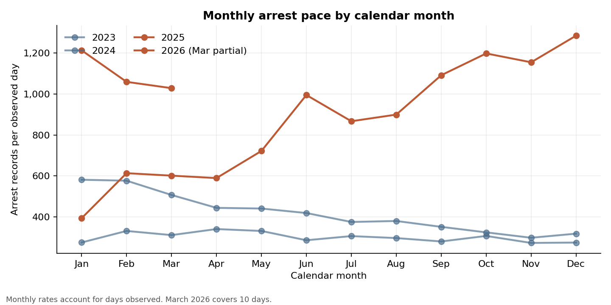

# ICE enforcement activity: what the records show

## The problem

How did recorded ICE arrest and detention activity change between 2023 and March 2026, where was it recorded, and do state-level arrest-rate patterns predict later economic or crime outcomes? I used administrative records from the [Deportation Data Project](https://deportationdata.org/) and joined them to population, economic, demographic, and crime data.

## Three findings

- **Activity:** recorded arrests averaged **358.9 per day** in 2023–2024 and **909.2 per day** from January 2025 to March 10, 2026 (+153%). Daily rates account for the unequal 731- and 434-day windows, but not seasonality.
- **Composition:** the convicted-criminal share of arrest records fell from **43.0% to 33.1%**; the pending-charge share rose from **17.4% to 29.0%**.
- **Inference:** none of the four primary 2025 lagged-outcome arrest-rate tests survived Benjamini–Hochberg adjustment at *q* < .10. This is limited evidence, not proof of no relationship.

## One key visual

The chart compares calendar months to make seasonal patterns visible. March 2026 is partial and uses 10 observed days; the headline daily-rate comparison does not adjust for seasonality.

## My contribution

I built the analysis from source reconciliation to reporting: deduplication and cohort checks; detention interval and censoring rules; external-data joins; matched DuckDB SQL and pandas aggregates; automated reconciliation tests; and a Streamlit dashboard over committed, aggregate-only tables.

For **analyst roles**, the project demonstrates source reconciliation, SQL, data quality, and communication. For **data-science roles**, it demonstrates inference, robust intervals, multiple-testing control, backtesting, and explicit limitations. Forecasting is a **baseline comparison**, not a deployed-model example: log-AR(1) did not beat the last-month baseline on 14 held-out months.

## Audience and limitations

The measures can help researchers, analysts, and journalists describe recorded activity and identify patterns for further study. Arrest records are not unique people or completed removals; apprehension and facility locations are not people’s residences. Facility population per local resident describes where people are held, not a local-resident detention rate. Neither the rates nor the exploratory state-level models measure individual risk or establish causal effects. Small samples, incomplete outcome coverage, confounding, and the short post-period limit inference.

See the [Final Report](final_report.md) for estimates and uncertainty, or the [technical guide](analysis/MASTER_RESULTS.md) for cohorts, model specifications, provenance, and reproduction details.
