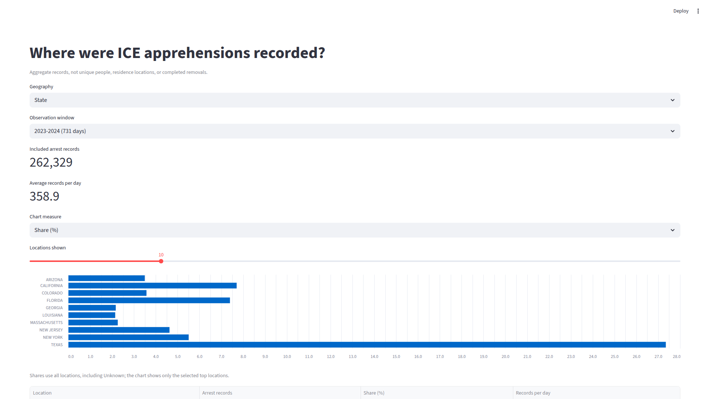

# ICE arrests and detention: from records to evidence

[](https://github.com/micahth/ice-data/actions/workflows/tests.yml)

**What changed in ICE enforcement, where was it recorded, and what can the data actually tell us?** I built a reproducible analysis of arrest and detention records from the [Deportation Data Project](https://deportationdata.org/data/ice.html), joining population, economic, demographic, and crime data to examine those questions.

Recorded arrests rose from **359 to 909 per day (+153%)** between 2023–2024 and January 2025–March 10, 2026; the convicted-criminal share fell from **43.0% to 33.1%**. The daily comparison adjusts for window length, not seasonality. None of four primary state arrest-rate tests survived multiple-testing adjustment at q < .10; these associations are exploratory, not causal.

**My contribution:** source reconciliation, cohort and censoring rules, SQL/pandas validation, statistical inference, forecasting, predictive modeling, and an interactive dashboard.

[Case study](CASE_STUDY.md) · [Final report](final_report.md) · [Methods and reproduction](docs/reproduction.md) · [Technical guide](analysis/MASTER_RESULTS.md)

## Explore the dashboard



The local dashboard uses committed aggregate tables, **without downloading raw data**. Compare states or ICE Areas of Responsibility, observation windows, and counts, shares, or records per day; download the full table.

```bash
python -m pip install -r requirements.txt
streamlit run analysis/dashboard.py --browser.gatherUsageStats=false
```

## Release and detention analysis

An exploratory scikit-learn logistic regression predicts whether a detention stay has a **recorded book-out within 30 days**, using admission date and first recorded facility. On 125,231 later admissions, its ROC AUC is **0.629** and Brier score **0.239**, versus **0.249** for a training-prevalence baseline. Training admissions have a 30-day observation window ending by the test period; recent admissions without 30 days of follow-up are excluded. Book-out is not necessarily release into the community, and missing book-outs may reflect incomplete records. This is a research demonstration, **not an individual decision tool**. [Model design, results, and reproduction](docs/reproduction.md#detention-stay-prediction).

This builds on the historical [Analysis #5: release and bond outcomes](https://github.com/micahth/ice-data/blob/f5a2fc76b2af2f4d280e60f413bc90d208376e0e/notebooks/findings_05_release_outcomes.md) ([original code](https://github.com/micahth/ice-data/blob/f5a2fc76b2af2f4d280e60f413bc90d208376e0e/notebooks/analysis_05_release_outcomes.py)). That earlier descriptive analysis is archived at its original revision and is not part of the current reproducible pipeline; its completed-stay comparisons are affected by censoring.

## What this demonstrates

- **Analysis:** cohort construction, explicit denominators, DuckDB SQL, data-quality checks, and aggregate reconciliation.
- **Statistics and modeling:** robust intervals, multiple-testing correction, sensitivity analyses, time-based validation, and baseline comparisons.
- **Communication:** a [case study](CASE_STUDY.md), [results and visualizations](outputs/README.md), and a dashboard for researchers, analysts, and journalists.

Arrests are records, not unique people or completed removals; apprehension and facility locations are not residence. Facility population per local resident measures where people are held, not residents' detention rates. Small samples, confounding, incomplete records, and changing observation windows limit inference. See the [report](final_report.md) and [technical guide](analysis/MASTER_RESULTS.md) for details.

**Stack:** Python, pandas, scikit-learn, DuckDB, statsmodels, Matplotlib, Streamlit, pytest, GitHub Actions. Code is [MIT licensed](LICENSE); third-party data retain their own terms. [AI use](docs/reproduction.md#ai-use).
