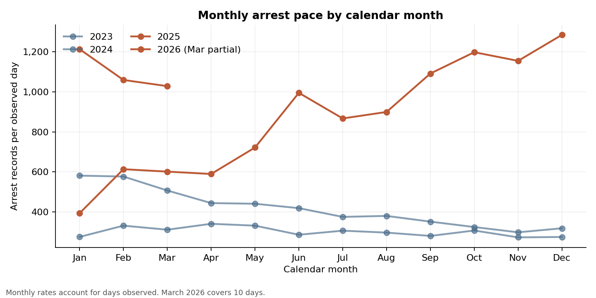

# ICE arrests and detention, 2023–2026

**Recorded arrests fell from 152,221 in 2023 to 110,108 in 2024, then rose to
317,032 in 2025.** The daily pace rose from 300.8 in 2024 to 868.6 in 2025.
These are arrest records, not unique people or completed removals.

- In the partial 2026 window through March 10, 77,558 records averaged 1,124.0 per day; this is not a full-year total or seasonally adjusted comparison.
- Arrest records classified as convicted-criminal fell from 43.0% to 33.1% between the two longer comparison windows, even as their daily rate rose.
- Facility average daily population per local resident rose in every region; this measures where people are held, not where they live.
- None of four primary 2025 arrest-rate tests survived BH adjustment at q < .10; associations are exploratory, not causal.

**Stack:** Python, pandas, statsmodels, Matplotlib, pytest, GitHub Actions.

**Explore:** [Case study](CASE_STUDY.md) · [Report](final_report.md) · [Methods and reproduction](docs/reproduction.md) · [Data source](https://deportationdata.org/data/ice.html) · [AI use](docs/reproduction.md#ai-use)
