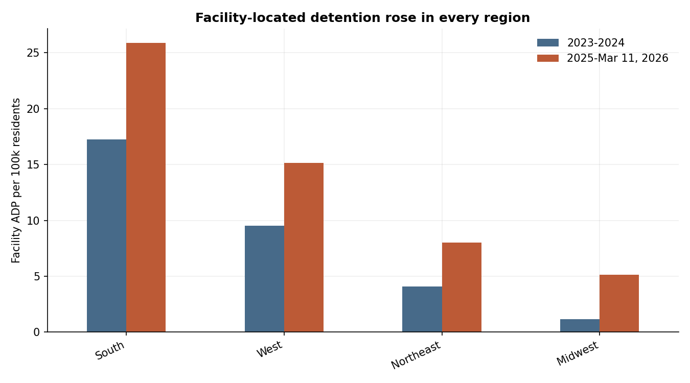
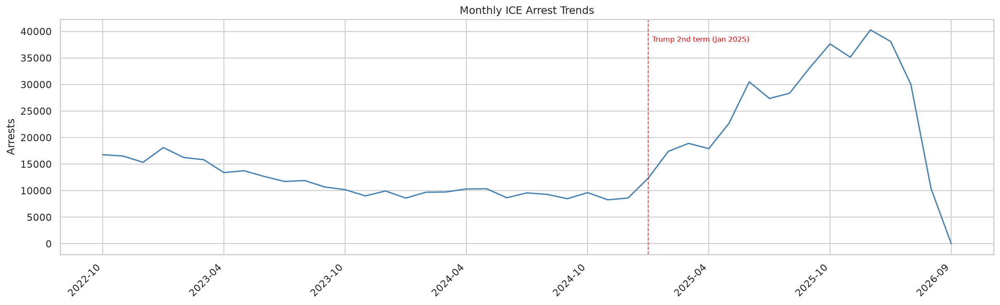
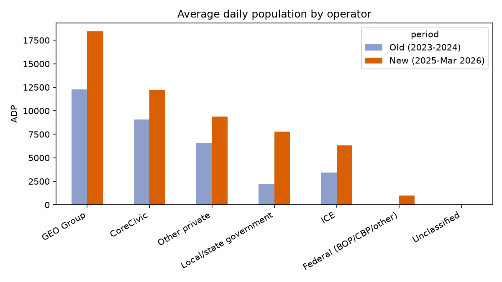
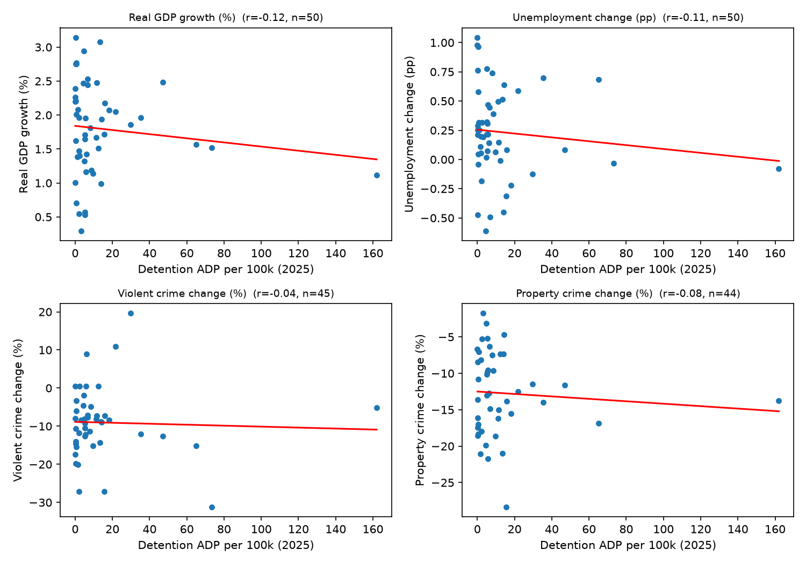

# ICE Detention & Arrests: A Geographic and Statistical Analysis (2022–2026)

[](https://github.com/micahth/ice-data/actions/workflows/tests.yml)
[](https://github.com/micahth/ice-data/actions/workflows/run-eda.yml)
[](LICENSE)
[](https://www.python.org/)

An end-to-end data-science study of U.S. Immigration and Customs Enforcement (ICE)
detention and arrest records obtained through Freedom of Information Act requests
(via the [Deportation Data Project](https://deportationdata.org/)). It combines
record-level interval math, geographic joins (county → CBSA → region), per-capita
normalization against Census population, and multivariable regressions with
multiple-testing correction against economic and crime outcomes.

> **Headline result:** A large enforcement shift with *no detectable state-level crime
> or economic signal.* Average daily detention population rose from ~33.6k (2023–24) to
> ~55.1k (2025–26) and daily arrests rose +153%, but across regressions with
> Benjamini–Hochberg correction, **no arrest-rate coefficient survives** correction
> against changes in GDP growth, unemployment, or violent/property crime.

---

## Research questions

1. **Where** is ICE detention concentrated, and how has its geographic footprint shifted
   between 2023–24 and 2025–26 (region, state, metro/micro/rural, facility operator)?
2. **How much** did enforcement intensity change on a per-capita basis, and for arrests?
3. **Is** the change in enforcement associated with state-level economic or crime
   outcomes once you control for population, demographics, politics, and lagged trends?

## Key findings

| | 2023–24 ("old") | 2025–26 ("new") |
|---|---:|---:|
| National average daily population (ADP) | 33.6k | 55.1k |
| ADP per 100k residents | ≈9.9 | ≈16.1 |
| Daily arrests | ~359 | ~909 (**+153%**) |
| Share of arrestees with a criminal conviction | 43.0% | 33.1% |
| Share with pending charges | 17.4% | 29.0% |

- **Geography.** Facility-located detention per resident rose in every region; the
  Midwest grew fastest (**+318%**), the South remains highest. Rural/non-metro facilities
  carry 3–7× the per-resident rate of metros.
- **Operators.** Private operators GEO and CoreCivic together hold ~56% of newer-period
  ADP; local/state facilities grew fastest (~3.5×). *Operator labels are inferred — ICE
  publishes none.*
- **Arrests.** Texas holds 25.7% of new-era arrests; the fastest-growing states are
  Virginia (+413%), Georgia (+332%), and the San Diego AOR (+961%).
- **No robust association.** 6 of 48 arrest-rate coefficients are nominally significant
  (near the chance screening rate); none survive multiple-testing correction. This is
  evidence of *no robust detectable association in this dataset*, not proof of zero effect.

### Selected figures

| Detention per 100k by region | Arrest volume over time |
|---|---|
|  |  |

| Average daily population by operator | 2025 detention rate vs. outcomes |
|---|---|
|  |  |

A full narrative with every figure and table is in
**[`notebooks/MASTER_RESULTS.md`](notebooks/MASTER_RESULTS.md)**, with plain-language
summaries in [`notebooks/press_releases/`](notebooks/press_releases/).

---

## Repository structure

```
.
├── data/                     # Raw FOIA extracts (Git LFS) + third-party codebook
├── docs/
│   └── REVIEW_NOTES.md        # Methodology audit, data-quality fixes, follow-up tests
├── notebooks/                 # Analysis pipeline (plain .py scripts, run in order)
│   ├── ice_lib.py             # Pure, unit-tested interval/ADP/annualization helpers
│   ├── geo_common.py          # Shared config, external-data fetch, geography joins
│   ├── eda.py                 # Exploratory data analysis + overview figures
│   ├── 05_geo_detention_analysis.py   # Division tables (region/state/operator/...)
│   ├── 06_geo_regressions.py          # Correlations + multivariable regressions
│   ├── 07_facility_changes.py         # Facilities opened/closed since 2025-01-20
│   ├── 08_figures.py                  # Publication figures
│   ├── 09_arrest_locations.py         # Arrest-location analysis
│   ├── 10_arrest_regressions.py       # Arrest-rate regressions
│   ├── data/                  # Small analysis input (Census age/sex estimates)
│   ├── figures/               # Generated PNG figures
│   ├── results/               # Generated result CSVs
│   ├── press_releases/        # Plain-language write-ups per result
│   └── MASTER_RESULTS.md      # Technical index to all results
├── tests/                     # pytest suite for ice_lib interval logic
├── requirements.txt
└── LICENSE
```

> **Script numbering.** The numbered scripts (`05`–`10`) are the reproducible analysis
> pipeline and run in order. `eda.py` is the standalone exploratory pass; the geographic
> pipeline begins at `05`. Earlier exploratory work (01–04) is summarized in
> [`docs/REVIEW_NOTES.md`](docs/REVIEW_NOTES.md) and
> [`notebooks/findings_04_administrations.md`](notebooks/findings_04_administrations.md)
> rather than kept as code.

## Setup

```bash
python -m venv .venv && source .venv/bin/activate
pip install -r requirements.txt
```

The raw ICE extracts in `data/` are stored with **Git LFS**. Clone with LFS installed
(`git lfs install` then `git clone …`) or run `git lfs pull` to hydrate them.

## Reproduce the analysis

```bash
# 1. Exploratory overview figures
python notebooks/eda.py

# 2. Geographic / per-capita / operator analysis pipeline (run in order)
python notebooks/05_geo_detention_analysis.py   # division tables  -> notebooks/results/
python notebooks/06_geo_regressions.py          # correlations + regressions
python notebooks/07_facility_changes.py         # facility open/close list
python notebooks/08_figures.py                  # publication figures
python notebooks/09_arrest_locations.py         # arrest-location tables
python notebooks/10_arrest_regressions.py       # arrest-rate regressions
```

External reference datasets (GDP, unemployment, crime, population, elections) are
downloaded on demand to `notebooks/.cache` (override with the `GEO_CACHE` env var).
Generated outputs land in `notebooks/results/` (CSVs) and `notebooks/figures/` (PNGs).

## Tests

Interval, ADP, and annualization logic in `notebooks/ice_lib.py` is covered by a pytest
suite (overlap clipping, censoring of open stints, boundary dates, negative/invalid
durations, missing book-outs):

```bash
python -m pytest tests/ -q
```

## Data provenance

- **Primary source:** ICE administrative arrests and detention stints/stays, obtained
  via FOIA and published by the [Deportation Data Project](https://deportationdata.org/).
  Files are named with a `7-24-2026` **extraction** date; the geographic analysis applies
  an event **cutoff** of 2026-03-11 (the last fully covered date).
- **Facility geography:** [deportationdata/ice-detention-facilities](https://github.com/deportationdata/ice-detention-facilities).
- **Reference data:** U.S. Census (population, ACS, age/sex), BEA (real GDP), BLS LAUS
  (unemployment), AH Datalytics Real-Time Crime Index, FBI state crime, OMB CBSA
  delineation, and MIT Election Lab returns. Full citations are in
  [`notebooks/MASTER_RESULTS.md`](notebooks/MASTER_RESULTS.md) and each press release.
- `data/codebook.txt` is third-party documentation (CC0) distributed with the source
  data, not project-authored.

## Limitations

This is **descriptive and correlational** work, not causal inference. Facility rates
divide facility ADP by *local* population and therefore describe where detention
*facilities* sit, not where detainees live; operator labels are inferred; the 2025–26
window is shorter and partially censored; and many comparisons are screened, so nominal
p-values are treated as exploratory unless they survive multiple-testing correction. See
the "Limitations" sections of `MASTER_RESULTS.md` and
[`docs/REVIEW_NOTES.md`](docs/REVIEW_NOTES.md) for details.

## License

Code is released under the [MIT License](LICENSE). The underlying ICE data and the
bundled codebook are the property of their respective sources and are subject to their
own terms.
