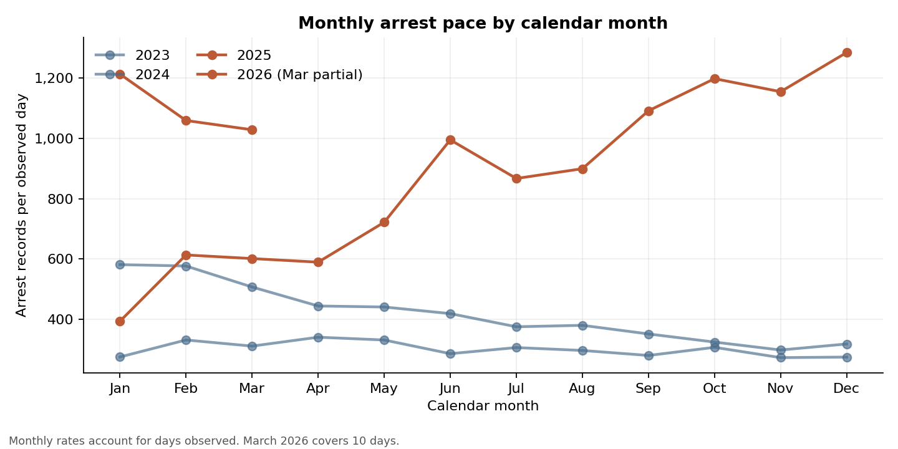
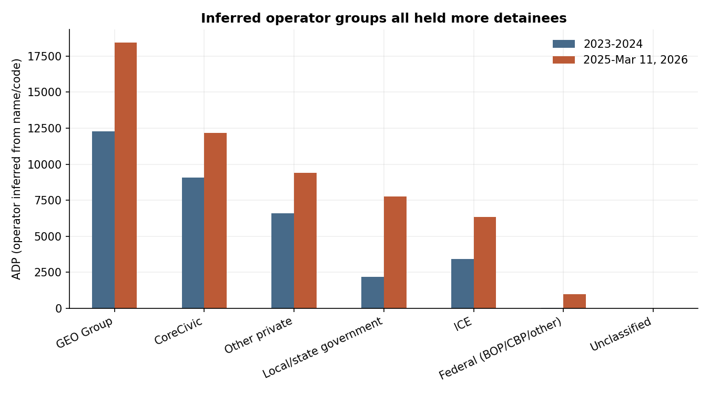
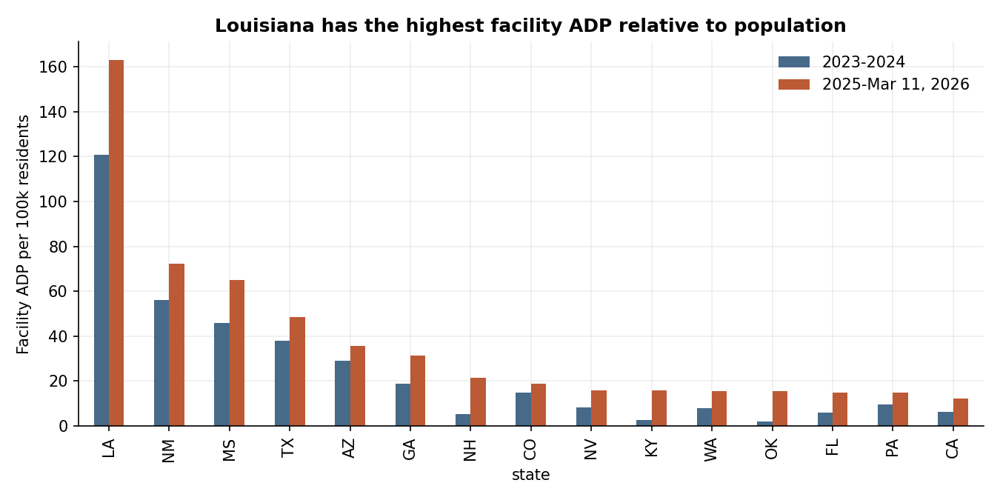
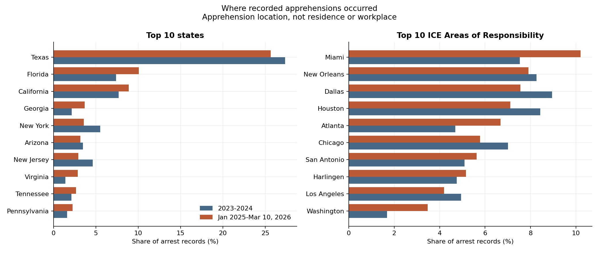
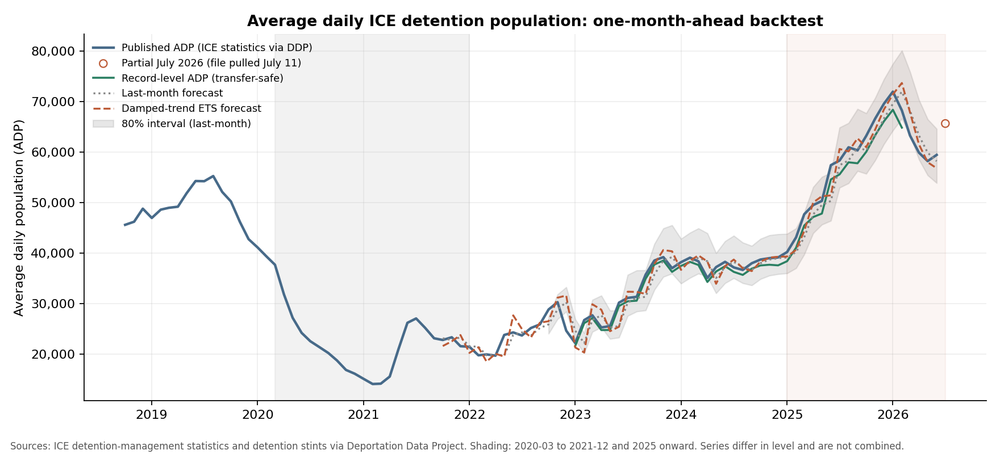
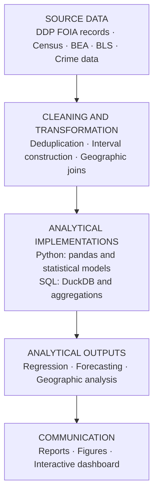

# ICE Detention & Arrests: A Geographic and Statistical Analysis (2023–2026)

[](https://github.com/micahth/ice-data/actions/workflows/tests.yml)



## Executive summary

**Portfolio case study:** [five-minute overview](CASE_STUDY.md) · [Final Report](final_report.md)

### Problem statement

How did U.S. Immigration and Customs Enforcement (ICE) arrest and detention activity
change between 2023 and March 2026, where is it concentrated, and are state arrest rates
associated with later economic or crime outcomes? The analysis uses 2023–2026 records
released by the [Deportation Data Project](https://deportationdata.org/) (administrative
records, not unique-person counts), joined with population, economic, demographic and crime data.

### Headline findings

- **Pace:** arrests per day rose from **359 to 909 (+153%)**, adjusting for unequal window lengths (not for seasonality).
- **Composition:** the convicted-criminal share of arrest records fell from **43.0% to 33.1%**; pending-charge share rose from 17.4% to 29.0%.
- **Geography:** facility average daily population per local resident rose in every region (where people are held, not a local-resident detention rate).
- **Inference:** none of the four primary 2025 lagged-outcome arrest-rate tests survives Benjamini–Hochberg adjustment at q < .10. Results are exploratory, not causal.

### Tech stack

| Layer | Tools |
|---|---|
| Data wrangling | Python 3.11/3.12, pandas, NumPy, PyArrow |
| SQL | DuckDB (`analysis/sql/`), run directly over the source CSV/parquet |
| Statistics | statsmodels (OLS, HC3/cluster-robust SEs, BH-FDR), SciPy |
| Forecasting | log-AR(1), last-month and seasonal-naive baselines, expanding-window backtests |
| Visualization | Matplotlib, seaborn, Streamlit dashboard |
| Quality | pytest on synthetic fixtures, GitHub Actions CI, Git LFS for raw data |

## Key findings

| Measure | 2023–2024 | Jan 2025–Mar 10, 2026 |
|---|---:|---:|
| Arrest records | 262,329 | 394,590 |
| Days observed | 731 | 434 |
| Arrests per day | 358.9 | 909.2 (+153%) |
| Convicted-criminal share of arrest records | 43.0% | 33.1% |
| Pending-charge share of arrest records | 17.4% | 29.0% |
| Detention average daily population | 33.6k | 55.1k |

- **Geography:** Facility ADP per local resident rose in every region. This is where
  people are held, not a local-resident detention rate.
- **Criminality:** arrest-record classifications describe people at apprehension, and
  are distinct from detention book-in categories.
- **Statistical uncertainty:** none of the four primary 2025 lagged-outcome
  arrest-rate tests survives Benjamini–Hochberg adjustment at q < .10. Other models
  are unadjusted sensitivity analyses; intervals and detection limits appear in the report.
- **Causality:** estimates are exploratory. Arrests are not completed removals, and
  employment status is not observed.
- **Annual timing:** economic comparisons use calendar-year outcomes, so the 2025
  arrest period starts January 1 rather than January 20; it is not an inauguration-date design.

## Results & visualizations

The 153% daily-rate comparison accounts for unequal window lengths; it does not adjust for seasonality. This calendar-month view places 2025–2026 alongside 2023–2024. March 2026 is partial and its rate uses 10 observed days.


| Monthly arrests over time | Facility ADP per 100k by region |
|---|---|
|  |  |

| 2025 facility rates vs. outcomes | Arrest-rate model estimates and confidence intervals |
|---|---|
|  |  |

| Facility ADP by operator | Top states |
|---|---|
|  |  |

| Arrest geography | ADP forecast vs. baselines |
|---|---|
|  |  |

All figures are regenerated by `python analysis/06_figures.py` from committed tables in
[`analysis/results/`](analysis/results); see also [`outputs/README.md`](outputs/README.md).

## Uncertainty-aware modeling

Every reported estimate carries an interval, and multiplicity is controlled for the
primary hypothesis family.

1. **Robust intervals.** State-level OLS uses HC3 standard errors with t-based 95% intervals
   (cluster-robust by state when states repeat), implemented in
   [`analysis/regression_common.py`](analysis/regression_common.py):
   `\hat\beta \pm t_{1-\alpha/2,\,df}\cdot \widehat{SE}_{HC3}(\hat\beta)`.
2. **Multiple testing.** The four primary outcome p-values are adjusted with
   Benjamini–Hochberg: `q_(i) = min_{j>=i} (m/j) p_(j)`, m = 4. Other models are labelled sensitivity analyses.
3. **Detectability.** Minimum detectable effects (`analysis/results/arrest_mde.csv`) show which effect sizes the sample could detect, so null results are not over-read.
4. **Influence diagnostics.** Cook's distance and leverage flag single-state drivers (e.g., Louisiana sensitivity).
5. **Forecast uncertainty.** Expanding-window, one-month-ahead backtests compare models to naive baselines.
6. **Data censoring.** Detention intervals are checked for censoring sensitivity (`analysis/results/detention_censoring_sensitivity.csv`).

```python
model = smf.ols(formula, data=data, missing="drop")
result = model.fit(cov_type="HC3", use_t=True)          # robust SEs
lower, upper = result.conf_int(alpha=0.05).loc[term]     # 95% CI
q = multipletests(p_primary, method="fdr_bh")[1]         # BH-adjusted q-values
```

## Read the analysis

- **[Case study](CASE_STUDY.md):** five-minute overview of the data problems, methods, and quality controls.
- **[Key outputs](outputs/README.md):** the four main figures with their source tables.
- **[Final Report](final_report.md):** primary findings, hypothesis, estimates, intervals, and limitations.
- **[Technical guide](analysis/MASTER_RESULTS.md):** cohorts, model specifications, provenance, and generated tables.
- **[Labor-market literature](analysis/LABOR_MARKET_LITERATURE.md):** research motivating the question and distinguishing this descriptive analysis from causal studies.
- **[Facility activity notes](analysis/FACILITY_CHANGES.md):** recorded new/stopped activity is not evidence of ownership changes.
- **[DDP codebook](data/codebook.txt):** third-party source documentation.

The six ordered scripts in `analysis/` form the main pipeline. `eda.py` is optional
exploratory analysis.

## Analytical pipeline



The ordered scripts use shared helper modules in `analysis/`; SQL queries live in
[`analysis/sql/`](analysis/sql), generated tables in
[`analysis/results/`](analysis/results), and figures in
[`analysis/figures/`](analysis/figures). The dashboard reads committed aggregates.

## Setup and tests

Python 3.11 or 3.12; direct Python dependencies are pinned (this is not a full
transitive lock file).

```bash
python -m venv .venv && source .venv/bin/activate
python -m pip install -r requirements.txt
python -m pytest -q
python analysis/06_figures.py
```

Tests and chart generation use synthetic fixtures and committed result tables. They
do not download raw LFS data or call external data services. CI runs the same test and
syntax checks without hydrating the large raw inputs.

## Reproduction status

| Item | Status |
|---|---|
| Source of published results | DDP CSV exports dated July 24, 2026 (`data/`, Git LFS) |
| Alternative download | `download_data.py` fetches a pinned July 6, 2026 parquet revision; **not byte-identical**, and exact reproduction of the published tables is not claimed or tested |
| Runs without raw data | `pytest` and `06_figures.py` (synthetic fixtures and committed result tables) |
| Needs raw data | Scripts `01`–`05`, which regenerate `analysis/results/` |

## Reproduce the full analysis

Raw FOIA CSV exports dated July 24, 2026 live in `data/` under Git LFS. To reproduce
the reported cohort from these exact exports:

```bash
git lfs install
git lfs pull --include="data/arrests_2026-07-24.csv,data/detention_stints*.csv" --exclude=""
python analysis/01_geo_detention_analysis.py
python analysis/02_geo_regressions.py
python analysis/03_facility_changes.py
python analysis/04_arrest_locations.py
python analysis/05_arrest_regressions.py
python analysis/06_figures.py
```

The July 24, 2026 extraction date differs from the event cutoff: arrest analysis
includes dates through March 10; detention analysis includes March 11. March 11 has
one arrest record and is excluded as a partial day; one stray September 2026 arrest
record is excluded as well.

Avoid downloading this repository's large LFS files by using the checksum-verified
direct DDP parquet downloader:

```bash
python analysis/download_data.py
export ICE_DATA_DIR="$PWD/data/raw"
```

It retrieves a pinned July 6, 2026 source revision; those data are **not byte-identical
to the July 24 CSV extracts**, so do not assume report numbers reproduce from that
alternative source. `--datasets arrests detention-stints detention-stays` also
downloads stays for the optional EDA script. Secondary inputs are fetched at immutable
revisions and cached under `analysis/.cache/`; see the technical guide for sources and
refresh details.

## SQL, interactive view and forecasting

The SQL path uses DuckDB directly over the original CSV (or selected parquet) to
deduplicate, apply the same cohort window, normalize locations, aggregate records,
and calculate window-normalized rates and shares. It is an alternative to pandas,
not a claim of faster execution; queries are in [`analysis/sql/`](analysis/sql).

```bash
python analysis/04_arrest_locations.py --engine duckdb --output-dir /tmp/ice-sql-results
streamlit run analysis/dashboard.py --browser.gatherUsageStats=false
python analysis/forecast_arrests.py
python analysis/forecast_adp.py
```

The local dashboard switches state/AOR, observation window and count/share/daily-rate
views, with CSV download; it reads only committed aggregates, not individual records.
The forecast example compares log-AR(1), last-month and seasonal-naive models with
expanding-window, one-month-ahead backtesting. It excludes partial March throughout.
Last-month forecasts outperform the fitted model on the 14 held-out months; this is
an honest baseline comparison, not evidence of deployment readiness. See the
[technical guide](analysis/MASTER_RESULTS.md#portfolio-examples).

A separate forecast covers the average daily detained population (ADP) from two sources that are
compared but never combined: ICE's published monthly statistics (via the Deportation Data Project) and
ADP computed from detention stints. No model beats last-month over the full published sample; this is
again not evidence of deployment readiness. Refresh the published series with
`python analysis/download_official_adp.py`; the record series needs the raw stints
(`python analysis/07_monthly_adp.py`).

## Repository structure

```text
data/                     Data sources: raw FOIA exports (Git LFS, not hand-edited) and codebook
notebooks/                Supplemental vintage and release-outcome analyses
analysis/                 Ordered pipeline scripts 01-07 and shared helpers
analysis/sql/             Commented DuckDB queries for cleaning and aggregation
analysis/results/         Generated summary tables (CSV)
analysis/figures/         Exported PNG figures
outputs/                  Landing page for the key figures and source tables
tests/                    Synthetic tests for cohorts, intervals, models and outputs
final_report.md           Reader-facing findings
requirements.txt          Pinned direct dependencies
LICENSE                   MIT license for the project code
```

## Limitations

This is descriptive and correlational, not causal: arrests are not completed
removals, and employment is unobserved. Apprehension locations and facility-
population denominators do not measure where people live or residents' likelihood
of detention. Small samples, confounding, incomplete outcomes, and wide intervals
limit conclusions; see the [Final Report](final_report.md) and
[technical guide](analysis/MASTER_RESULTS.md).

## Data citation

Holmquist, M. (2026). *ICE enforcement data analysis* [Data analysis project; software].
https://github.com/micahth/ice-data

Deportation Data Project. (2026). *ICE administrative records* [Data set; July 24,
2026 export]. https://deportationdata.org/data/ice.html

The code is released under the [MIT License](LICENSE). ICE data and third-party
documentation are provided by their respective sources under their own terms.
