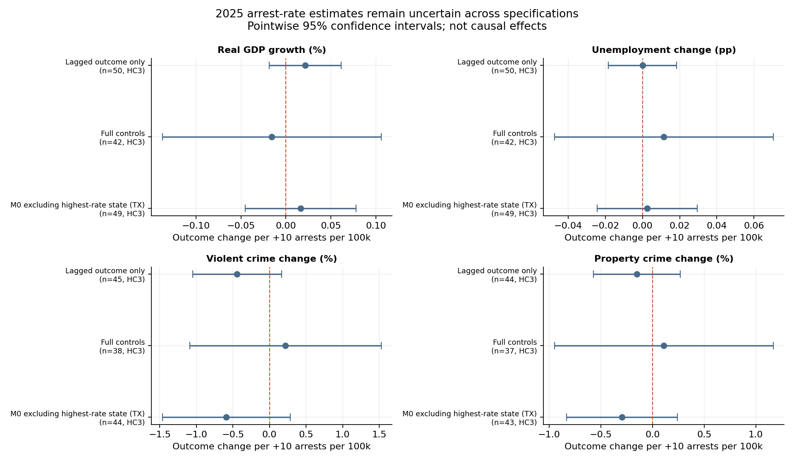

# ICE Detention & Arrests: A Geographic and Statistical Analysis (2022–2026)

[](https://github.com/micahth/ice-data/actions/workflows/run-eda.yml)

An analysis of U.S. Immigration and Customs Enforcement (ICE) arrest, detainer, and
detention records released by the [Deportation Data Project](https://deportationdata.org/).
It combines record-level interval logic, geographic joins, population normalization,
and state-level economic/crime associations.

> **Headline:** Daily arrests rose from about **359 to 909 (+153%)** between 2023–2024
> and January 2025–March 10, 2026. The share of arrest records classified as convicted
> criminal fell from **43.0% to 33.1%**. State-level models do not establish reliable
> associations with economic or crime trends. Confidence intervals remain wide.
> Arrests are not deportations, employment records, or residence locations.

## Research questions

1. Where are ICE detention facilities and apprehensions concentrated, and how did the recorded activity change?
2. How did detention ADP and arrest pace change after normalizing for time and population?
3. Are state arrest rates associated with changes in state economic or crime outcomes?

## Key findings

| Measure | 2023–2024 | Jan 2025–Mar 10, 2026 |
|---|---:|---:|
| Arrest records | 262,329 | 394,590 |
| Days observed | 731 | 434 |
| Arrests per day | 358.9 | 909.2 (+153%) |
| Convicted-criminal share of arrest records | 43.0% | 33.1% |
| Pending-charge share of arrest records | 17.4% | 29.0% |
| Detention average daily population | 33.6k | 55.1k |

- **Geography:** Facility ADP per local resident rose in every region. This is where
  people are held, not a local-resident detention rate.
- **Criminality:** arrest-record classifications describe people at apprehension, and
  are distinct from detention book-in categories.
- **Statistical uncertainty:** none of 64 arrest-related coefficients survives
  Benjamini–Hochberg adjustment at q < .10. 2025-only models use HC3 robust intervals;
  estimates and sensitivity checks appear in the report.
- **Causality:** estimates are exploratory. Arrests are not completed removals, and
  employment status is not observed.

### Selected figures

| Monthly arrests | Facility ADP per 100k by region |
|---|---|
|  |  |

| 2025 facility rates vs. outcomes | Arrest-rate model estimates and confidence intervals |
|---|---|
|  |  |

## Read the analysis

- **[Final Report](Final%20Report.md):** primary findings, hypothesis, estimates, intervals, and limitations.
- **[Technical guide](notebooks/MASTER_RESULTS.md):** cohorts, model specifications, provenance, and generated tables.
- **[Policy sources](notebooks/POLICY_SOURCES.md):** primary-source claims motivating the question; claims are not treated as findings.
- **[Facility activity notes](notebooks/FACILITY_CHANGES.md):** recorded new/stopped activity is not evidence of ownership changes.
- **[DDP codebook](data/codebook.txt):** third-party source documentation.

The numbered scripts `05`–`10` are analysis identifiers, not missing prerequisites.
`eda.py` is optional exploratory analysis.

## Setup and tests

Python 3.11 or 3.12; direct Python dependencies are pinned (this is not a full
transitive lock file).

```bash
python -m venv .venv && source .venv/bin/activate
python -m pip install -r requirements.txt
python -m pytest -q
python notebooks/08_figures.py
```

Tests and chart generation use synthetic fixtures and committed result tables. They
do not download raw LFS data or call external data services. CI runs the same test and
syntax checks without hydrating the large raw inputs.

## Reproduce the full analysis

Raw FOIA CSV exports dated July 24, 2026 live in `data/` under Git LFS. To reproduce
the reported cohort from these exact exports:

```bash
git lfs install
git lfs pull --include="data/arrests-latest 7-24-2026.csv,data/detention-stints*.csv" --exclude=""
python notebooks/05_geo_detention_analysis.py
python notebooks/06_geo_regressions.py
python notebooks/07_facility_changes.py
python notebooks/09_arrest_locations.py
python notebooks/10_arrest_regressions.py
python notebooks/08_figures.py
```

The July 24, 2026 extraction date differs from the event cutoff: arrest analysis
includes dates through March 10; detention analysis includes March 11. March 11 has
one arrest record and is excluded as a partial day; one stray September 2026 arrest
record is excluded as well.

Avoid downloading this repository's large LFS files by using the checksum-verified
direct DDP parquet downloader:

```bash
python notebooks/download_data.py
export ICE_DATA_DIR="$PWD/data/raw"
```

It retrieves a pinned July 6, 2026 source revision; those data are **not byte-identical
to the July 24 CSV extracts**, so do not assume report numbers reproduce from that
alternative source. `--datasets arrests detention-stints detention-stays` also
downloads stays for the optional EDA script. Secondary inputs are fetched at immutable
revisions and cached under `notebooks/.cache/`; see the technical guide for sources and
refresh details.

## Repository structure

```text
data/                     Raw FOIA exports (LFS) and third-party codebook
notebooks/                Python analysis scripts, cached inputs, results, figures
tests/                    Synthetic tests for cohorts, intervals, models and outputs
Final Report.md           Reader-facing findings
requirements.txt          Pinned direct dependencies
LICENSE                   MIT license for the project code
```

## Limitations

This is descriptive and correlational, not causal inference. Apprehension location is
not necessarily residence or workplace. The analysis does not observe work
authorization, employment, deportation outcomes, or voluntary departures. GDP growth
is not a necessary consequence of wage or fiscal claims; labor supply and demand can
both change. Small state samples, missing outcomes, confounding, changing enforcement
targets, and wide confidence intervals preclude ruling out meaningful effects.
Facility-location population denominators are not resident detention rates, and
operator labels are inferred. See the [Final Report](Final%20Report.md) and
[technical guide](notebooks/MASTER_RESULTS.md) for details.

## Data citation

Holmquist, M. (2026). *ICE enforcement data analysis* [Data analysis project; software].
https://github.com/micahth/ice-data

Deportation Data Project. (2026). *ICE administrative records* [Data set; July 24,
2026 export]. https://deportationdata.org/data/ice.html

The code is released under the [MIT License](LICENSE). ICE data and third-party
documentation are provided by their respective sources under their own terms.
