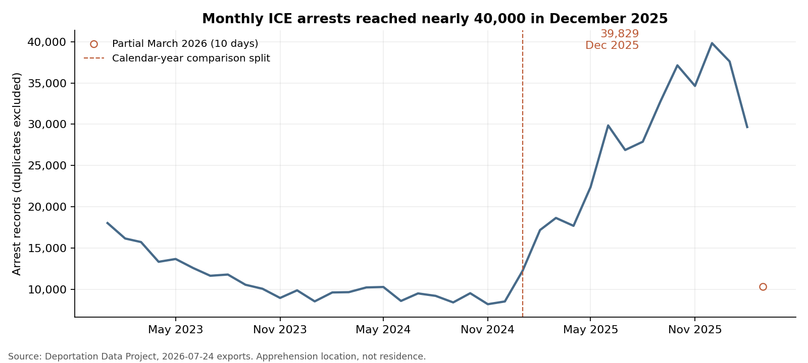
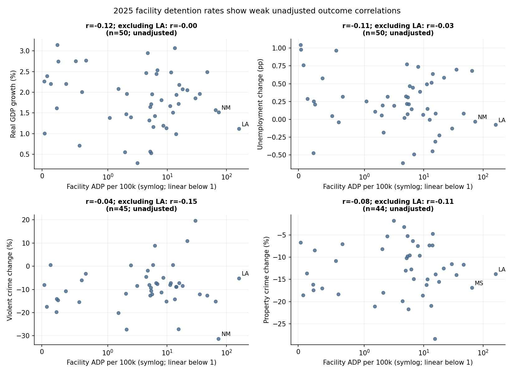
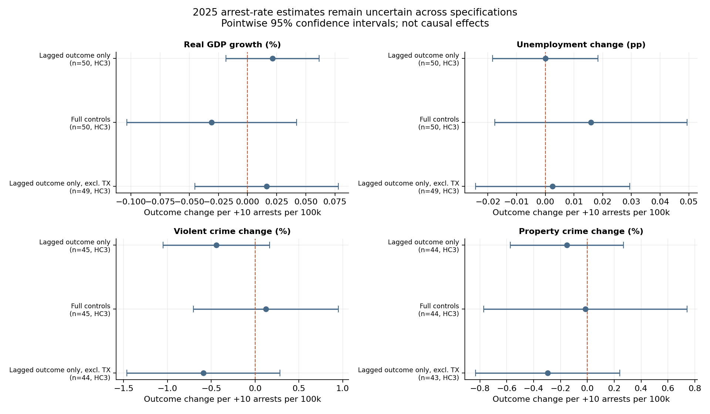
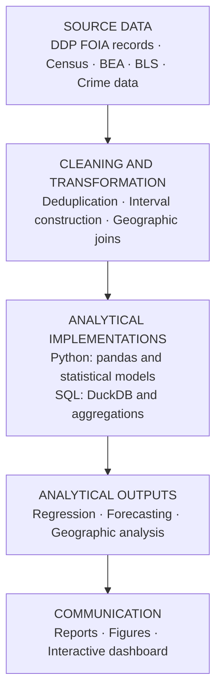

# ICE Detention & Arrests: A Geographic and Statistical Analysis (2023–2026)

[](https://github.com/micahth/ice-data/actions/workflows/tests.yml)

The primary analysis covers 2023–2026 U.S. Immigration and Customs Enforcement (ICE)
arrest and detention records released by the [Deportation Data Project](https://deportationdata.org/).
A supplemental vintage notebook also describes detainer records. The project combines
record-level interval logic, geographic joins, population normalization, and state-level
economic/crime associations.

**Portfolio case study:** [Read the five-minute overview](CASE_STUDY.md) or go straight
to the [Final Report](final_report.md).

- **Question:** How did ICE arrest and detention activity change over time and
  geographically, and were state arrest rates associated with economic or crime outcomes?
- **Data:** ICE arrest and detention records from the [Deportation Data Project](https://deportationdata.org/),
  joined with population, economic, demographic, and crime data. The analysis uses
  administrative records, not unique-person counts.
- **Findings:** Arrests per day rose from **359 to 909 (+153%)**, while the share of
  arrest records classified as convicted criminal fell from **43.0% to 33.1%**.
  Primary state-level tests did not establish reliable associations; results are
  exploratory, not causal.
- **Skills:** Python, SQL/DuckDB, data validation and integration, geographic analysis,
  statistical modeling with uncertainty, forecasting/backtesting, and automated tests.

## Research questions

1. Where are ICE detention facilities and apprehensions concentrated, and how did the recorded activity change?
2. How did detention, Average Daily Population of People Detained (ADP), and arrest pace change after normalizing for time and population?
3. Are state arrest rates associated with changes in state economic or crime outcomes?

## Key findings

| Measure | 2023–2024 | Jan 2025–Mar 10, 2026 |
|---|---:|---:|
| Arrest records | 262,329 | 394,590 |
| Days observed | 731 | 434 |
| Arrests per day | 358.9 | 909.2 (+153%) |
| Convicted-criminal share of arrest records | 43.0% | 33.1% |
| Pending-charge share of arrest records | 17.4% | 29.0% |
| Detention average daily population | 33.6k | 55.1k |

- **Geography:** Facility ADP per local resident rose in every region. This is where
  people are held, not a local-resident detention rate.
- **Criminality:** arrest-record classifications describe people at apprehension, and
  are distinct from detention book-in categories.
- **Statistical uncertainty:** none of the four primary 2025 lagged-outcome
  arrest-rate tests survives Benjamini–Hochberg adjustment at q < .10. Other models
  are unadjusted sensitivity analyses; intervals and detection limits appear in the report.
- **Causality:** estimates are exploratory. Arrests are not completed removals, and
  employment status is not observed.
- **Annual timing:** economic comparisons use calendar-year outcomes, so the 2025
  arrest period starts January 1 rather than January 20; it is not an inauguration-date design.

### Selected figures

The 153% daily-rate comparison accounts for unequal window lengths; it does not adjust for seasonality. This calendar-month view places 2025–2026 alongside 2023–2024. March 2026 is partial and its rate uses 10 observed days.


| Monthly arrests over time | Facility ADP per 100k by region |
|---|---|
|  |  |

| 2025 facility rates vs. outcomes | Arrest-rate model estimates and confidence intervals |
|---|---|
|  |  |

## Read the analysis

- **[Case study](CASE_STUDY.md):** five-minute overview of the data problems, methods, and quality controls.
- **[Key outputs](outputs/README.md):** the four main figures with their source tables.
- **[Final Report](final_report.md):** primary findings, hypothesis, estimates, intervals, and limitations.
- **[Technical guide](analysis/MASTER_RESULTS.md):** cohorts, model specifications, provenance, and generated tables.
- **[Labor-market literature](analysis/LABOR_MARKET_LITERATURE.md):** research motivating the question and distinguishing this descriptive analysis from causal studies.
- **[Facility activity notes](analysis/FACILITY_CHANGES.md):** recorded new/stopped activity is not evidence of ownership changes.
- **[DDP codebook](data/codebook.txt):** third-party source documentation.

The six ordered scripts in `analysis/` form the main pipeline. `eda.py` is optional
exploratory analysis.

## Analytical pipeline



The ordered scripts use shared helper modules in `analysis/`; SQL queries live in
[`analysis/sql/`](analysis/sql), generated tables in
[`analysis/results/`](analysis/results), and figures in
[`analysis/figures/`](analysis/figures). The dashboard reads committed aggregates.

## Setup and tests

Python 3.11 or 3.12; direct Python dependencies are pinned (this is not a full
transitive lock file).

```bash
python -m venv .venv && source .venv/bin/activate
python -m pip install -r requirements.txt
python -m pytest -q
python analysis/06_figures.py
```

Tests and chart generation use synthetic fixtures and committed result tables. They
do not download raw LFS data or call external data services. CI runs the same test and
syntax checks without hydrating the large raw inputs.

## Reproduction status

| Item | Status |
|---|---|
| Source of published results | DDP CSV exports dated July 24, 2026 (`data/`, Git LFS) |
| Exact-file download | `download_data.py` defaults to the four published CSVs at an immutable repository revision, with SHA-256 and size verification |
| Reproduction check | `reproduce.py` regenerates and compares all 30 committed CSV result tables, including headline statistics; full-data check passed |
| Alternative download | `download_data.py --source alternative` fetches the pinned July 6, 2026 parquet revision; **not byte-identical** and not a reproduction source |
| Runs without raw data | `pytest` and `06_figures.py` (synthetic fixtures and committed result tables) |
| Needs raw data | Scripts `01`–`05`, which regenerate `analysis/results/` |

## Reproduce the full analysis

The published analysis uses exactly **four** July 24 CSVs: the arrest export and
all three detention-stint parts (including the undated `detention_stints_part3.csv`).
Individual filenames, SHA-256 checksums, sizes and the immutable source revision are
in the [source manifest](analysis/published_inputs.json) and
[technical guide](analysis/MASTER_RESULTS.md#exact-published-inputs).
The other raw files are not inputs to the published pipeline.

After setup, download these exact files (2.56 GB total) without needing Git LFS,
then regenerate and check the published results:

```bash
python analysis/download_data.py
unset ICE_DATA_DIR
python analysis/reproduce.py --work-dir /tmp/ice-reproduction
```

The workspace path must not already exist. The check verifies every source checksum,
uses a fresh secondary-input/cache directory, runs scripts `01`–`05` and the forecast,
and compares **all 30 result CSVs** against the Git `HEAD` snapshot. This covers
arrest counts, daily rates, criminality shares, detention ADP, panels and model
tables—not just internal reconciliation. Missing/extra tables or changed text,
counts or numeric values fail the command (absolute floating-point tolerance
`1e-6`, no relative tolerance; row order is ignored). Logs and regenerated tables
remain in the workspace; tracked outputs are never overwritten. The full check
requires network access for pinned secondary inputs and more disk/memory than
the lightweight tests; use at least 8 GB RAM and 8 GB free disk.

Alternatively, hydrate the same objects using Git LFS and verify their identity:

```bash
git lfs install
git lfs pull --include="data/arrests_2026-07-24.csv,data/detention_stints*.csv" --exclude=""
python analysis/download_data.py --verify-only
```

For manual execution (overwrites working-tree outputs), run:

```bash
unset ICE_DATA_DIR
python analysis/01_geo_detention_analysis.py
python analysis/02_geo_regressions.py
python analysis/03_facility_changes.py
python analysis/04_arrest_locations.py
python analysis/05_arrest_regressions.py
python analysis/06_figures.py
```

The July 24, 2026 extraction date differs from the event cutoff: arrest analysis
includes dates through March 10; detention analysis includes March 11. March 11 has
one arrest record and is excluded as a partial day; one stray September 2026 arrest
record is excluded as well.

### Alternative source: July 6 parquet (not published-result reproduction)

For exploratory analysis of a different source revision, use:

```bash
python analysis/download_data.py --source alternative
export ICE_DATA_DIR="$PWD/data/raw"
```

It retrieves a pinned July 6, 2026 source revision; those data are **not byte-identical
to the July 24 CSV extracts**, so do not assume report numbers reproduce from that
alternative source. Adding `--datasets arrests detention-stints detention-stays` also
downloads stays for the optional EDA script. Secondary inputs are fetched at immutable
revisions and cached under `analysis/.cache/`; see the technical guide for sources and
refresh details.

## SQL, interactive view and forecasting

The SQL path uses DuckDB directly over the original CSV (or selected parquet) to
deduplicate, apply the same cohort window, normalize locations, aggregate records,
and calculate window-normalized rates and shares. It is an alternative to pandas,
not a claim of faster execution; queries are in [`analysis/sql/`](analysis/sql).

```bash
python analysis/04_arrest_locations.py --engine duckdb --output-dir /tmp/ice-sql-results
streamlit run analysis/dashboard.py --browser.gatherUsageStats=false
python analysis/forecast_arrests.py
python analysis/forecast_adp.py
```

The local dashboard switches state/AOR, observation window and count/share/daily-rate
views, with CSV download; it reads only committed aggregates, not individual records.
The forecast example compares log-AR(1), last-month and seasonal-naive models with
expanding-window, one-month-ahead backtesting. It excludes partial March throughout.
Last-month forecasts outperform the fitted model on the 14 held-out months; this is
an honest baseline comparison, not evidence of deployment readiness. See the
[technical guide](analysis/MASTER_RESULTS.md#portfolio-examples).

A separate forecast covers the average daily detained population (ADP) from two sources that are
compared but never combined: ICE's published monthly statistics (via the Deportation Data Project) and
ADP computed from detention stints. No model beats last-month over the full published sample; this is
again not evidence of deployment readiness. Refresh the published series with
`python analysis/download_official_adp.py`; the record series needs the raw stints
(`python analysis/07_monthly_adp.py`).

## Repository structure

```text
data/                     Raw FOIA exports (LFS) and third-party codebook
analysis/                 Ordered scripts, SQL, dashboard, forecast, results, figures
outputs/                  Landing page for the four key figures
tests/                    Synthetic tests for cohorts, intervals, models and outputs
final_report.md           Reader-facing findings
requirements.txt          Pinned direct dependencies
LICENSE                   MIT license for the project code
```

## Limitations

This is descriptive and correlational, not causal: arrests are not completed
removals, and employment is unobserved. Apprehension locations and facility-
population denominators do not measure where people live or residents' likelihood
of detention. Small samples, confounding, incomplete outcomes, and wide intervals
limit conclusions; see the [Final Report](final_report.md) and
[technical guide](analysis/MASTER_RESULTS.md).

## Data citation

Holmquist, M. (2026). *ICE enforcement data analysis* [Data analysis project; software].
https://github.com/micahth/ice-data

Deportation Data Project. (2026). *ICE administrative records* [Data set; July 24,
2026 export]. https://deportationdata.org/data/ice.html

The code is released under the [MIT License](LICENSE). ICE data and third-party
documentation are provided by their respective sources under their own terms.
