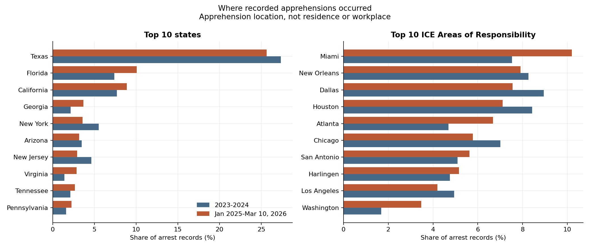

# ICE enforcement expanded; state-level outcome estimates remain uncertain

Micah Holmquist | Deportation Data Project CSV exports dated July 24, 2026

## Question and motivation

How did ICE arrest and detention activity change, and did states with higher arrest rates also experience different economic or crime trends?

The labor-market effects of enforcement are an empirical question, not a one-direction prediction. East et al. find that Secure Communities reduced employment among likely undocumented immigrants and U.S.-born workers, illustrating how labor-market responses can differ from a simple competition story ([Journal of Labor Economics, 2023](https://doi.org/10.1086/721152)). This project asks a narrower descriptive question: whether **state arrest intensity is associated with annual state outcome changes**. Arrests do not identify workers removed from employment.

## Main findings

| Measure | 2023–2024 | Jan 2025–Mar 10, 2026 |
|---|---:|---:|
| Included arrest records | 262,329 | 394,590 |
| Window length | 731 days | 434 days |
| Arrests per day | 358.9 | 909.2 |
| Convicted-criminal share of arrest records | 43.0% | 33.1% |
| Pending-charge share of arrest records | 17.4% | 29.0% |

Daily arrest pace increased **153%**; monthly arrests peaked at **39,829 in December 2025**. Texas accounted for 25.7% of newer-period arrests. Differences describe recorded apprehension locations, not arrestees' residences. Criminality categories describe arrest records, not unique detainees or proven effects on crime.

National detention average daily population (ADP) increased from **33.6k to 55.1k**, using a detention window ending March **11**, 2026 (435 newer-period days). Facility ADP per resident rose in every region; rural facilities held about 78.4 detainees per 100,000 local residents versus 10.9 in metropolitan counties. These measure where facilities hold people, **not local residents' likelihood of detention**. Operator classifications are inferred, not verified ownership records.

## Where apprehensions occurred

Recorded apprehensions are concentrated but became somewhat less concentrated in Texas. By state, Texas's share fell from 27.3% to 25.7% while Florida rose from 7.4% to 10.1% and Georgia from 2.2% to 3.7%; the ten largest states account for 65.8% of newer-period records. By ICE Area of Responsibility, Miami (10.2%), New Orleans (7.9%) and Dallas (7.6%) lead, with Atlanta and Washington gaining the most share. Landmark-level records are far more dispersed (6,393 distinct labels; top ten = 22.3%), and many are generic "general area" entries, so they reflect reporting convention as much as place. Full tables: `arrests_by_state.csv`, `arrests_by_aor.csv` and `arrests_by_landmark.csv` in `analysis/results/`.

This uses apprehension location rather than detention-facility location, which reflects bed capacity and transfers. Neither measures where people live or work.

## State-level associations and uncertainty

The panel covers 50 states in 2023–2025. All controls are now complete for every state-year; crime sample sizes remain smaller because of outcome-source coverage. The primary testing family is the four **2025 arrest-rate coefficients in the lagged-outcome specification**. Other eras and specifications are sensitivity analyses; repeated-year models include year effects. The full-control specification is not a preferred high-dimensional model for a small cross-section.

2025 estimates below use HC3 heteroskedasticity-robust standard errors and t-based, **pointwise 95% confidence intervals**. Coefficients are outcome change per additional 10 arrests per 100,000 residents:

| Outcome | Lagged outcome only: estimate [95% CI], n | Full controls: estimate [95% CI], n |
|---|---|---|
| Real GDP growth (percentage points) | 0.021 [−0.019, 0.061], 50 | −0.031 [−0.104, 0.042], 50 |
| Unemployment change (percentage points) | 0.000 [−0.018, 0.018], 50 | 0.016 [−0.018, 0.049], 50 |
| Violent crime rate change (%) | −0.444 [−1.051, 0.164], 45 | 0.123 [−0.703, 0.948], 45 |
| Property crime rate change (%) | −0.151 [−0.573, 0.270], 44 | −0.016 [−0.773, 0.741], 44 |

Across the four primary arrest-rate tests, **none passes Benjamini–Hochberg q < .10** (q = .573, .998, .573 and .629 in table order). The other 60 arrest-related coefficients are reported with unadjusted p-values as sensitivity analyses, not pooled into the primary correction. This family was defined during revision after inspecting earlier results, not preregistered. Because that post-hoc choice could understate multiplicity, a transparency sensitivity analysis instead applies Benjamini–Hochberg across **all 64 arrest exposure coefficients**—the broadest family, which cannot have been narrowed after seeing results—and still finds **no q < .10** (smallest q = .59; column `q_bh_all_exposure` in `arrest_regressions.csv`). The null arrest-rate result is therefore not an artifact of how the primary family was drawn. Even so, the primary tests are confirmatory only in a weak sense: any single association near a threshold should be read as exploratory and would need out-of-sample replication before being relied upon. Removing Texas, the highest arrest-rate state in 2025, does not resolve uncertainty in the reduced-control models. The [coefficient chart](analysis/figures/fig6_arrest_coefficients.png) shows both specifications and that sensitivity check. These intervals allow positive and negative associations; they are not equivalence tests or multiplicity-adjusted intervals.

**Coverage correction:** an earlier global `mode == "TOTAL"` election filter discarded ID, NC, RI, UT, WA, WI, WV and WY, where the pinned source records unsplit returns with missing voting mode. Selecting totals within each state, with unsplit rows as the fallback, restores all 51 election jurisdictions. Both regression scripts now fail if any control is missing for any of the 50 analysis states. The corrected full-control samples rose from 42/42/38/37 to 50/50/45/44. The primary estimates are unchanged; full-control point estimates and intervals above are regenerated, not carried forward.

For scale, the interquartile range of 2025 state arrest rates is about **54 per 100,000**, or 5.4 units of the model's +10-per-100,000 scale. Across that range, the lagged-outcome intervals translate to about **−0.10 to +0.10 percentage points** for unemployment change, **−0.10 to +0.33 points** for GDP growth, and **−5.7% to +0.9%** for violent-crime change. Under this specification, the confidence intervals are comparatively narrow for unemployment change, providing evidence against very large state-level associations. They do not establish that the true association is zero, and the intervals are pointwise rather than multiplicity-adjusted. The violent-crime interval still allows a meaningful reduction.

**Detection limits:** with only 44–50 states and one post-period year, approximate minimum detectable associations at 80% power and nominal two-sided alpha = .05 are **0.31 percentage points of GDP growth, 0.14 points of unemployment change, 4.66% violent-crime change and 3.23% property-crime change** across that arrest-rate IQR. These use `(t(.975, residual df) + z(.80)) × HC3 SE × IQR/10` ([generated table](analysis/results/arrest_mde.csv)). They are retrospective precision-based approximations conditional on the fitted design and variance, not a prospective power calculation or observed power; multiplicity would generally increase detection thresholds. Nonsignificance therefore does not rule out smaller associations, particularly for crime.

## Methods and limitations

Arrest counts are deduplicated records, not unique people or completed removals; apprehension location need not be residence or workplace. The January 1, 2025 split is a calendar-year comparison, not an intervention-date design. March 2026 is partial, and regression models omit partial-year 2026.

Detention ADP is overlapping bed-days divided by actual window days. Facility-stint comparisons use recorded book-outs where available and censor qualifying open stints at March 12, 2026; 1,049 older open records are excluded. No release-rate comparison is reported because censoring makes it unreliable.

The primary models are parsimonious; full-control models are a sensitivity check. Single-year models use HC3 intervals, and repeated-state models use state-clustered inference. Intervals are pointwise, not multiplicity-adjusted. Small samples, confounding, model dependence, incomplete crime coverage, and unobserved employment limit interpretation; the [technical guide](analysis/MASTER_RESULTS.md) documents specifications and data handling.

Same-year arrests may respond to local economic deterioration or crime changes, rather than precede them; this reverse-causality mechanism is not removed by lagged outcome controls.

**Conclusion:** the enforcement increase is well supported descriptively. This dataset does not establish a reliable state-level economic or crime association, and cannot confirm or refute the causal economic effects of deportation.
