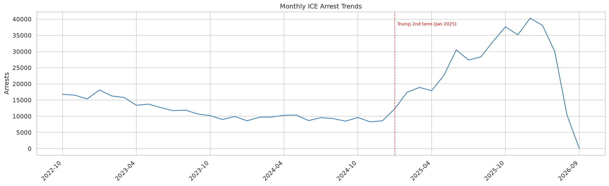
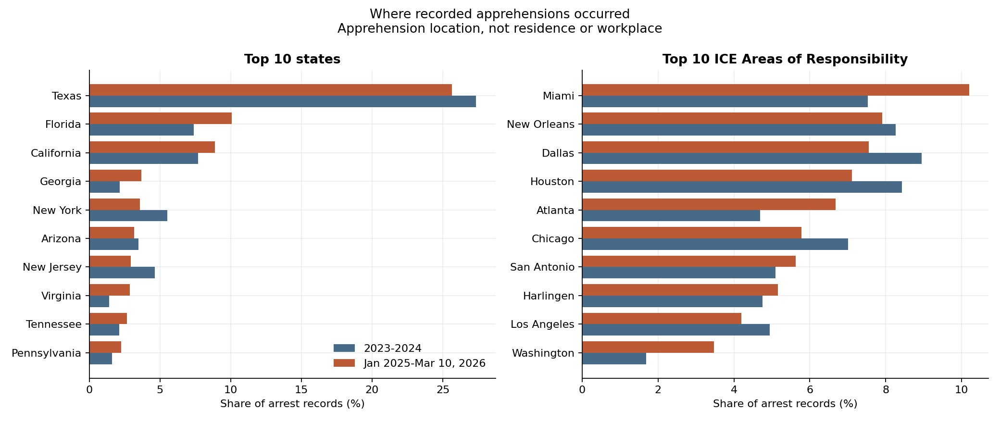
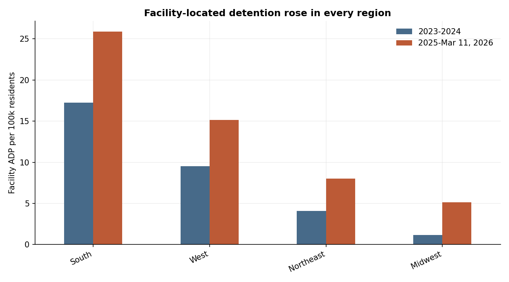
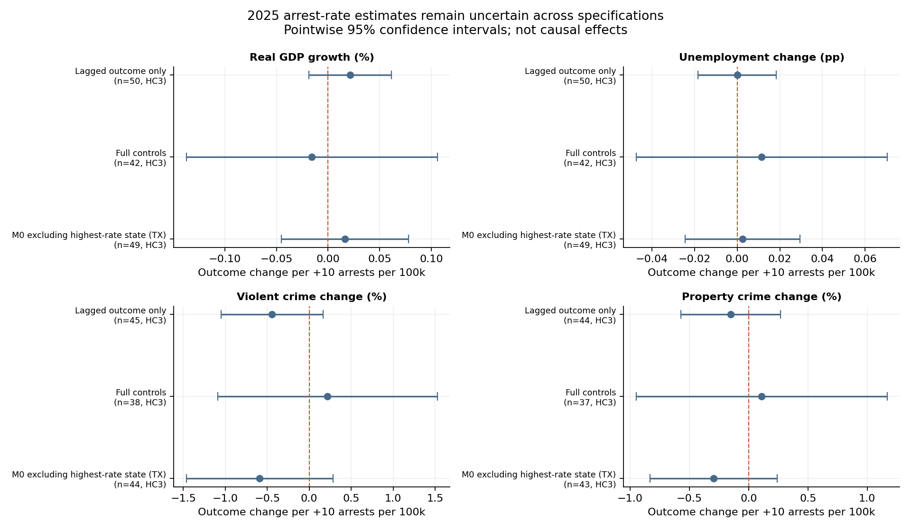

# Key outputs

Four figures that summarize the analysis, with the table behind each. Figures are regenerated by `python notebooks/08_figures.py` from the committed tables in `notebooks/results/`.

> See [`index.html`](index.html) for a single-page, full-size viewer of all four figures.

## 1. Arrests over time

Monthly deduplicated arrest records peaked at 39,829 in December 2025; March 2026 is partial. Daily arrests rose from about 359 to 909. Records, not unique people.
Data: [`monthly_arrests.csv`](../notebooks/results/monthly_arrests.csv), [`arrest_summary.csv`](../notebooks/results/arrest_summary.csv)

## 2. Where apprehensions occurred

Share of arrest records by state and ICE Area of Responsibility in each period. Apprehension location, not residence or workplace.
Data: [`arrests_by_state.csv`](../notebooks/results/arrests_by_state.csv), [`arrests_by_aor.csv`](../notebooks/results/arrests_by_aor.csv), [`arrests_by_landmark.csv`](../notebooks/results/arrests_by_landmark.csv)

## 3. Detention geography

Facility average daily population per 100,000 local residents rose in every region. This shows where people are held, not local residents' likelihood of detention.
Data: [`by_region.csv`](../notebooks/results/by_region.csv)

## 4. State-level regression estimates

Pointwise 95% confidence intervals for the association between 2025 state arrest rates and outcome changes. None of 64 arrest-related coefficients survives multiple-testing adjustment; these are not causal effects.
Data: [`arrest_regressions.csv`](../notebooks/results/arrest_regressions.csv)

See the [Case study](../CASE_STUDY.md) and [Final Report](../Final%20Report.md) for interpretation and limitations.
